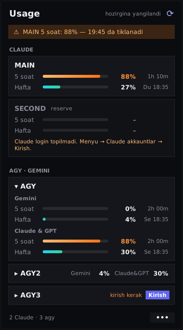

# Usage — Windows versiyasi

**Claude Code** va **agy** (Google Antigravity CLI / Gemini) akkauntlaringizning **5 soatlik** va **haftalik** limitlarini bitta joyda ko'rsatadigan kichik Windows tray dasturi.
Asl macOS dasturi ([usage-bar](https://github.com/thexayotbe/usage-bar)) ning Windows 11 uchun Python porti.



- **Tray ikonka** (soat yonida): halqa + raqam = 5 soatlik limitning necha foizi ishlatilgan.
  Rang: yashil < 70 · sariq 70–85 · to'q sariq 85–95 · qizil ≥ 95. Kichik to'q sariq nuqta = qaysidir akkauntga kirish kerak yoki ma'lumot eskirgan.
  Claude akkaunt bo'lmasa, ikonka agy akkauntlarining eng yuqori 5 soatlik foizini ko'rsatadi.
- **Chap tugma** → oyna: har bir Claude akkaunt kartasi, har bir agy akkaunt qatori (bosilsa ochiladi: Gemini va Claude & GPT, 5 soat + hafta).
- **O'ng tugma** → menyu (yangilash, akkaunt qo'shish, sozlamalar, chiqish).

## Talablar

- Windows 10/11
- Python 3.10+ ([python.org](https://www.python.org/downloads/), o'rnatishda **"Add python.exe to PATH"** ni belgilang)
- `agy` o'rnatilgan va hech bo'lmasa bitta akkaunt bilan kirilgan (va/yoki Claude Code)

## O'rnatish

1. Papkani istalgan joyga qo'ying, masalan `C:\Users\<siz>\usage-bar-windows`.
2. **`install.bat`** ni ikki marta bosing — `pystray` va `pillow` o'rnatiladi va dastur ishga tushadi.
3. Soat yonida halqa ikonka paydo bo'ladi (ko'rinmasa — `^` strelka ichida; uni sudrab tashqariga chiqaring).
4. Windows bilan birga ochilishi uchun: oynada **`•••` → "Windows bilan birga ishga tushirish"**.

Keyingi safar ishga tushirish: **`start.bat`**.

## 3 ta Gemini (agy) akkauntni ulash

`agy` login ma'lumotini foydalanuvchi papkasida (`HOME` / `USERPROFILE`) saqlaydi. Shuning uchun har bir qo'shimcha akkaunt —
alohida "uy papkasi": `C:\Users\<siz>\.agy-accounts\agy2`, `...\agy3`. Dastur `agy` ni shu papka bilan ishga tushiradi.

1. **1-akkaunt** — oddiy `agy`. Agar hali kirmagan bo'lsangiz, terminalda `agy` ni ochib Google akkaunt bilan kiring, keyin `/quit`.
2. **2-akkaunt** — `agy_akkaunt_qoshish.bat` ni ishga tushiring, nomini bo'sh qoldiring (→ `agy2`).
   Yangi qora oyna ochiladi: **ikkinchi** Google akkaunt bilan kiring, keyin `/quit` yozib oynani yoping.
3. **3-akkaunt** — yana `agy_akkaunt_qoshish.bat` (→ `agy3`), **uchinchi** Google akkaunt bilan kiring, `/quit`.
4. Tray → **"Sozlamalarni qayta yuklash"** (yoki ⟳ tugmasi).

Xuddi shuni dastur ichidan ham qilish mumkin: **`•••` → agy akkauntlar → "Yangi agy akkaunt qo'shish…"**.
Kirilmagan akkaunt qatorida **"kirish kerak"** va **Kirish** tugmasi chiqadi — u to'g'ri papka bilan `agy` ni ochadi.

Natijada `config.json` taxminan shunday bo'ladi (namuna: [`config.example.json`](config.example.json)):

```json
"agy": [
  { "name": "agy",  "enabled": true },
  { "name": "agy2", "home": "~/.agy-accounts/agy2", "enabled": true },
  { "name": "agy3", "home": "~/.agy-accounts/agy3", "enabled": true }
]
```

> **Agar 2- va 3-akkaunt baribir 1-akkauntni ko'rsatsa** — demak `agy` loginni boshqa joyda (masalan `%APPDATA%`) saqlayapti.
> Unda akkauntga `env` qo'shing, masalan:
> `{ "name": "agy2", "home": "~/.agy-accounts/agy2", "env": { "APPDATA": "~/.agy-accounts/agy2/AppData/Roaming", "LOCALAPPDATA": "~/.agy-accounts/agy2/AppData/Local" } }`
> va **Kirish** ni qayta bosing.

## Sozlamalar

Fayl: `C:\Users\<siz>\.config\usage-bar\config.json` (birinchi ishga tushishda avtomatik yaratiladi). Tahrirlash: **`•••` → Sozlamalarni ochish…**, keyin **Sozlamalarni qayta yuklash**.

| Kalit | Ma'nosi |
|---|---|
| `refreshMinutes` | Har necha daqiqada yangilash (standart 5). Claude API 5 daqiqadan tez so'ralmaydi. |
| `menuBarAccount` | Tray ikonkada ko'rsatiladigan Claude akkaunt nomi (standart: birinchisi). |
| `trayIcon` | `"number"` (halqa + raqam) yoki `"rings"` (ikki halqa: tashqi 5 soat, ichki hafta). |
| `agyPath` | `agy` topilmasa, uning to'liq yo'li, masalan `"C:/Users/siz/AppData/Roaming/npm/agy.cmd"`. |
| `claude[]` | `{ "name", "label"?, "configDir" }` — Claude Code config papkasi (`~/.claude`). `label: "reserve"` kartani xiraroq qiladi. |
| `agy[]` | `{ "name", "home"?, "enabled", "env"? }` — yuqoriga qarang. |
| `quotaFile` | Ixtiyoriy: tarmoq o'rniga shu JSON fayldan o'qish (asl README'dagi format). |

**Claude Code** (bo'lsa): Windows'da token `C:\Users\<siz>\.claude\.credentials.json` da turadi — dastur shuni o'qiydi.
Bir nechta Claude akkaunt: `CLAUDE_CONFIG_DIR=C:\Users\siz\.claude-ish` bilan kiring va `claude` ro'yxatiga qo'shing.

## Muammolar

| Belgi | Yechim |
|---|---|
| Ikonka chiqmadi | `check.bat` ni ishga tushiring — har bir akkaunt natijasi yoki xatosi chiqadi. `python usage_bar.py` (w siz) xatoni ko'rsatadi. |
| `agy topilmadi` | `where agy` buyrug'i nima chiqarsa, o'shani `agyPath` ga yozing. |
| agy qatori *kirish kerak* | **Kirish** → ochilgan oynada Google bilan kiring → `/quit`. |
| `agy /quota javob bermadi` | `agy -p "/quota"` ni terminalda qo'lda tekshiring. |
| "Claude login topilmadi" / "token eskirgan" | O'sha akkauntda Claude Code'ni bir marta oching (token yangilanadi). |
| 429 | Anthropic cheklovi: dastur o'zi kutadi va oxirgi raqamlarni ko'rsatadi. |

## Maxfiylik

- Claude: `GET https://api.anthropic.com/api/oauth/usage` — faqat o'zingizning tokeningiz bilan. Token hech qayerga yozilmaydi.
- agy: faqat `agy -p "/quota"` ishga tushiriladi; Google bilan agy'ning o'zi gaplashadi.
- Kesh: `%LOCALAPPDATA%\usage-bar\cache.json` (faqat foizlar va vaqtlar).

## O'chirish

`•••` → "Windows bilan birga…" belgisini olib tashlang → **Chiqish**. Keyin papkani va `C:\Users\<siz>\.config\usage-bar` ni o'chiring.
