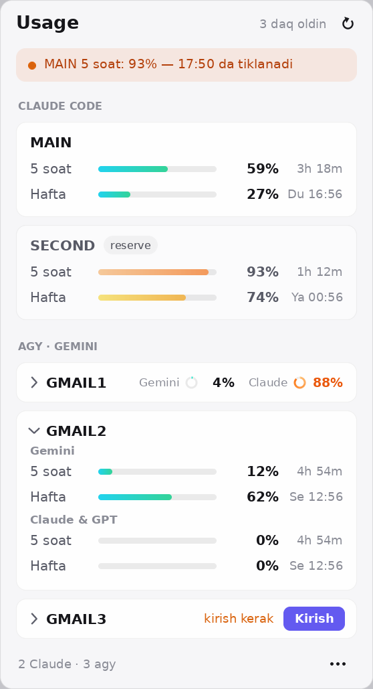

# Usage — Windows versiyasi

**Claude Code** va **agy** (Google Antigravity CLI / Gemini) akkauntlaringizning **5 soatlik** va **haftalik** limitlarini bitta joyda ko'rsatadigan kichik Windows tray dasturi.
Asl macOS dasturi ([usage-bar](https://github.com/thexayotbe/usage-bar)) ning Windows 10/11 uchun Python porti.

 

- **Tray ikonka** (soat yonida): halqa + raqam = 5 soatlik limitning necha foizi ishlatilgan.
  Rang: yashil < 70 · sariq 70–85 · to'q sariq 85–95 · qizil ≥ 95. Kichik to'q sariq nuqta = qaysidir akkauntga kirish kerak yoki ma'lumot eskirgan.
  Claude akkaunt bo'lmasa, ikonka agy akkauntlarining eng yuqori 5 soatlik foizini ko'rsatadi.
- **Chap tugma** → oyna: har bir Claude akkaunt kartasi, har bir agy akkaunt qatori (bosilsa ochiladi: Gemini va Claude & GPT, 5 soat + hafta).
- **O'ng tugma** → menyu (yangilash, akkaunt qo'shish, sozlamalar, chiqish).
- Oyna Windows'ning yorug'/qorong'i mavzusiga moslashadi.

## Talablar

- Windows 10 yoki 11
- Python 3.10+ — [python.org](https://www.python.org/downloads/) dan o'rnating va o'rnatishda **"Add python.exe to PATH"** ni belgilang.
  Yoki PowerShell'da: `winget install Python.Python.3.12`
- `agy` o'rnatilgan va hech bo'lmasa bitta Google akkaunt bilan kirilgan (va/yoki Claude Code)

## O'rnatish

1. Papkani istalgan joyga qo'ying, masalan `C:\Users\<siz>\usage-bar-windows`
   (yoki `git clone https://github.com/AbbosCoder/usage-bar-windows`).
2. **`install.bat`** ni ikki marta bosing. U:
   - `pystray` va `pillow` ni o'rnatadi (`pip install --user`);
   - papkani foydalanuvchi **PATH**'iga qo'shadi — `agy-acc` buyrug'i istalgan terminalda ishlaydi;
   - Claude Code uchun `agy` skill'ini o'rnatadi (`%USERPROFILE%\.claude\skills\agy`);
   - dasturni ishga tushiradi.
3. Soat yonida halqa ikonka paydo bo'ladi. Ko'rinmasa — `^` strelka ichida; uni sudrab panelga chiqaring.
4. Windows bilan birga ochilishi uchun: oynada **`•••` → "Windows bilan birga ishga tushirish"**
   (`HKCU\Software\Microsoft\Windows\CurrentVersion\Run` ga yoziladi, administrator huquqi kerak emas).

Keyingi safar ishga tushirish: **`start.bat`** (konsol oynasisiz, `pythonw` bilan).

> SmartScreen "Windows protected your PC" desa: **More info → Run anyway**. `.bat` fayllar oddiy matn — ochib ko'rishingiz mumkin.

## Bir nechta Gmail (agy) akkauntni ulash

Windows'da `agy` bitta umumiy loginni ishlatadi (Credential Manager → `gemini:antigravity`). Shuning uchun har bir gmail
loginini saqlab qo'yib, kerak bo'lganda almashtiradigan **`agy-acc`** buyrug'i bor. `install.bat` dan keyin **yangi** terminal oching
(PowerShell, cmd yoki Windows Terminal):

```powershell
agy-acc save gmail1     # agy'ga allaqachon kirgan bo'lsangiz (aks holda: agy-acc add gmail1)
agy-acc add gmail2      # agy ochiladi → 2-gmail bilan kiring → /quit
agy-acc list            # * = hozir faol
agy-acc use gmail2      # terminaldagi agy endi gmail2 limitidan foydalanadi
```

| Buyruq | Nima qiladi |
|---|---|
| `agy-acc list` / `current` | saqlangan akkauntlar / hozirgi akkaunt |
| `agy-acc save NOM` | agy'da hozir kirilgan loginni NOM nomi bilan saqlash |
| `agy-acc add NOM` | yangi gmail: agy ochiladi → kirasiz → `/quit` |
| `agy-acc use NOM` | agy (va Antigravity) ni NOM akkauntiga o'tkazish |
| `agy-acc open NOM` yoki shunchaki `NOM` | NOM ga o'tib agy'ni ochish (`agy1.bat`, `agy2.bat`… avtomatik yaratiladi) |
| `agy-acc login NOM` | token eskirgan bo'lsa qayta kirish |
| `agy-acc rename ESKI YANGI` · `email NOM GMAIL` · `remove NOM` | nomlash, gmailni yozib qo'yish, o'chirish |
| `agy-acc quota [--json] [--refresh]` | har bir akkaunt limiti (% ishlatilgan) |
| `agy-acc run "vazifa"` | vazifani limiti eng ko'p qolgan akkauntdagi `agy -p` ga berish. agy **joriy papkada** fayllarni yaratadi, tahrirlaydi, o'chiradi; `--read-only` — faqat javob (`run --help`) |
| `agy-acc doctor` | muammoni aniqlash (tokenlar ko'rsatilmaydi) |

> ⚠️ Saqlangan akkaunt uchun `agy` ichida **`/logout` qilmang** — Google tokeni bekor bo'lib qolishi mumkin.

**Claude Code skill:** `install.bat` o'rnatgan `agy` skill'i bilan agy Claude Code'ning **subagenti** bo'ladi: vazifani Claude'ga berasiz,
u bir qismini (funksiya yozish, testlar, refaktor…) limiti ko'p qolgan Gemini akkauntidagi agy'ga topshiradi, agy loyihada fayllarni o'zi
o'zgartiradi, Claude esa `git diff` ni tekshirib ishni yakunlaydi — Claude limiti kamroq sarflanadi.
**To'liq qo'llanma: [AGY_AKKAUNTLAR.md](AGY_AKKAUNTLAR.md).**

## Sozlamalar

Fayl: `%USERPROFILE%\.config\usage-bar\config.json` (birinchi ishga tushishda avtomatik yaratiladi; namuna: [config.example.json](config.example.json)).
Tahrirlash: **`•••` → Sozlamalarni ochish…**, keyin **Sozlamalarni qayta yuklash**.
JSON ichida yo'llarni `/` bilan yoki `\\` bilan yozing (`"C:/Users/siz/..."`).

| Kalit | Ma'nosi |
|---|---|
| `refreshMinutes` | Har necha daqiqada yangilash (standart 5). Claude API 5 daqiqadan tez so'ralmaydi. |
| `menuBarAccount` | Tray ikonkada ko'rsatiladigan Claude akkaunt nomi (standart: birinchisi). |
| `theme` | Oyna mavzusi: `"auto"` (Windows sozlamasiga qarab), `"dark"` yoki `"light"`. |
| `trayIcon` | `"number"` (halqa + raqam) yoki `"rings"` (ikki halqa: tashqi 5 soat, ichki hafta). |
| `agyPath` | `agy` topilmasa, uning to'liq yo'li, masalan `"C:/Users/siz/AppData/Local/agy/bin/agy.exe"`. |
| `claude[]` | `{ "name", "label"?, "configDir" }` — Claude Code config papkasi (`%USERPROFILE%\.claude`). `label: "reserve"` kartani xiraroq qiladi. |
| `agy[]` | `{ "name", "enabled" }` — `agy-acc` o'zi qo'shadi. |
| `agyCredential` | agy loginining Credential Manager'dagi nomi (standart `gemini:antigravity`). |
| `quotaFile` | Ixtiyoriy: tarmoq o'rniga shu JSON fayldan o'qish (asl README'dagi format). |

**Claude Code** (bo'lsa): token `%USERPROFILE%\.claude\.credentials.json` da turadi — dastur shuni o'qiydi.
Bir nechta Claude akkaunt: har biriga alohida papka bilan kiring va uni `claude` ro'yxatiga qo'shing:

```powershell
$env:CLAUDE_CONFIG_DIR = "$env:USERPROFILE\.claude-ish"; claude
```

```json
"claude": [
  { "name": "shaxsiy", "configDir": "C:/Users/siz/.claude" },
  { "name": "ish", "configDir": "C:/Users/siz/.claude-ish", "label": "reserve" }
]
```

## Muammolar

| Belgi | Yechim |
|---|---|
| Ikonka chiqmadi | `check.bat` ni ishga tushiring — har bir akkaunt natijasi yoki xatosi chiqadi. `python usage_bar.py` (`pythonw` emas) xatoni konsolda ko'rsatadi. |
| `agy-acc` topilmadi | `install.bat` dan keyin terminalni **qayta oching**. Bo'lmasa to'liq yo'l bilan: `C:\...\usage-bar-windows\agy-acc.bat`. |
| `agy topilmadi` | PowerShell'da `where.exe agy` (oddiy `where` emas) nima chiqarsa, o'shani `agyPath` ga yozing. |
| `python` Microsoft Store'ni ochadi | Settings → Apps → Advanced app settings → **App execution aliases** → `python.exe` va `python3.exe` ni o'chiring. |
| agy qatori *kirish kerak* | **Kirish** (yoki `agy-acc login NOM`) → Google bilan kiring → `/quit`. |
| *agy / Antigravity ochiq* | Ochiq turgan agy'ga tegilmasligi uchun boshqa akkauntlar u yopilgach yangilanadi. |
| "hozirgi login hech qayerda saqlanmagan" | agy tokenni o'zi yangilagan: `agy-acc save NOM` bilan shu akkaunt ustiga qayta saqlang. |
| Hamma akkaunt bir xil raqam | `agy-acc list` — har biriga turli email yozilganini tekshiring; `agy-acc doctor`. |
| `agy /quota javob bermadi` | `agy -p "/quota"` ni terminalda qo'lda tekshiring. |
| "Claude login topilmadi" / "token eskirgan" | Dastur tokenni `.credentials.json` dagi refresh token bilan o'zi yangilaydi. Bu ham rad etilsa (masalan faqat Claude desktop ilovasidan foydalansangiz), terminalda `claude` → `/login` qiling. |
| 429 | Anthropic cheklovi: dastur o'zi kutadi va oxirgi raqamlarni ko'rsatadi. |

## Maxfiylik

- Claude: `GET https://api.anthropic.com/api/oauth/usage` — faqat o'zingizning tokeningiz bilan. Token hech qayerga yozilmaydi.
- agy: faqat `agy -p "/quota"` ishga tushiriladi; Google bilan agy'ning o'zi gaplashadi.
- Saqlangan agy loginlari faqat Windows Credential Manager'da (`usage-bar/agy/<nom>`) turadi.
- Kesh: `%LOCALAPPDATA%\usage-bar\cache.json` (faqat foizlar va vaqtlar).

## O'chirish

1. Oynada `•••` → "Windows bilan birga…" belgisini olib tashlang → **Chiqish**.
2. Papkalarni o'chiring: dastur papkasi, `%USERPROFILE%\.config\usage-bar`, `%LOCALAPPDATA%\usage-bar`, `%USERPROFILE%\.claude\skills\agy`.
3. Saqlangan agy loginlari: **Control Panel → Credential Manager → Windows Credentials** → `usage-bar/agy` bilan boshlanadigan yozuvlarni (`usage-bar/agy/<nom>`, `usage-bar/agy-backup`) o'chiring
   (`gemini:antigravity` ga tegmang — u agy'ning o'z logini).
4. PATH: **Settings → System → About → Advanced system settings → Environment Variables** → foydalanuvchi `Path` idan dastur papkasini olib tashlang.
